<!-- gráfico de contribuições animado com dados reais
     (regerado diariamente por .github/workflows/update-profile-art.yml) -->

<h3><code>bryan@github ~ $ ./contributions.sh</code></h3>

 
 

<!-- retrato ascii (esquerda) + card de stats (direita), ambos 840x880.
     retrato: python scripts/prep_photo.py <foto.png> && python scripts/make_ascii_svg.py
     stats:   python scripts/render_stats_svg.py (mesmo workflow diário) -->

<h3><code>bryan@github ~ $ whoami</code></h3>

<table>
<tr>
<td valign="top"></td>
<td valign="top"></td>
</tr>
</table>

 
 

<h3><code>bryan@github ~ $ ./links.sh</code></h3>

<b>Fullstack Developer</b>

<!-- TODO: trocar SEU_USUARIO / SEU_SITE pelos links reais -->

 

